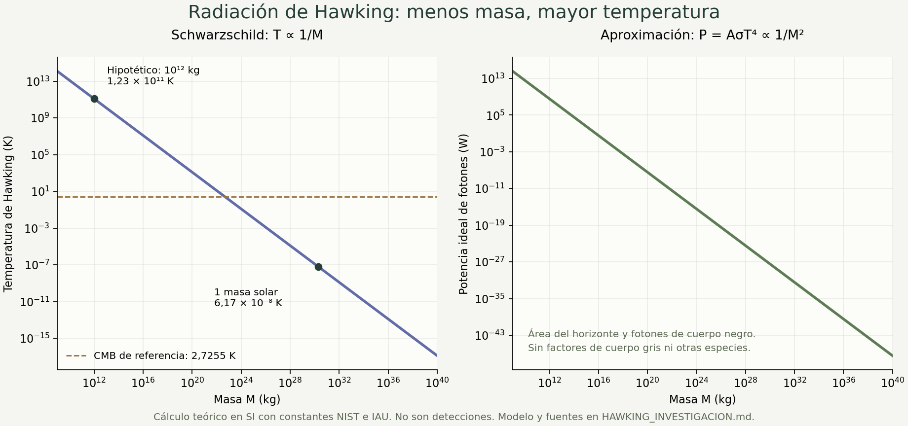

# Radiación de Hawking y diseño del tercer laboratorio

Fecha de corte: **20 de octubre de 2026**. Destino: tercer laboratorio de SPUM, después de doble rendija y prisma. Estado: investigación científica y especificación; la interfaz del tercer laboratorio todavía no está implementada.

La propuesta es una **simulación de las consecuencias de un modelo semiclásico**, con masa, temperatura, espectro y evolución relacionadas por ecuaciones. El aprendizaje central será que un agujero negro menos masivo tiene mayor temperatura de Hawking. La simulación permitirá explorar esa predicción; la evidencia física se presentará en una sección separada, con su alcance identificado.

## Qué se predice y qué se ha medido

La radiación de Hawking surge al estudiar campos cuánticos sobre un espacio-tiempo con horizonte. Para un agujero negro que se forma por colapso, el estado inicialmente vacío contiene una población térmica de modos salientes para observadores lejanos. No requiere que una señal clásica salga desde el interior del horizonte. Hawking anunció el resultado en 1974 y desarrolló el cálculo en 1975. [Artículo original de 1975](https://doi.org/10.1007/BF02345020), [bibliografía de Hawking](https://www.hawking.org.uk/in-print?start=22).

| Sistema o resultado | Qué aporta | Qué permite afirmar |
| --- | --- | --- |
| Agujeros negros astronómicos | Observaciones de sus efectos gravitatorios y del material circundante | Su existencia y propiedades tienen evidencia propia; eso no constituye una detección de Hawking. |
| Radiación de Hawking gravitatoria | Predicción semiclásica y búsquedas astrofísicas | Las fuentes consultadas hasta esta fecha no aportan una detección astronómica confirmada. |
| Análogo en condensado de Bose–Einstein, 2019 | Los autores miden correlaciones y un espectro térmico con temperatura relacionada con el horizonte acústico | Prueba de determinadas relaciones de un sistema análogo, con fonones, no de la evaporación de un agujero negro astronómico. |
| Análogo en condensado, publicación de 2021 | Los autores estudian estacionariedad y evolución temporal en seis momentos | Amplía el estudio del sistema análogo; sus horizontes y evolución pertenecen al condensado. |
| Fibra óptica, 30 de mayo de 2026 | Emisión análoga **estimulada por un fotón**; se caracterizan espectro, intensidad y correlación de segundo orden condicionada | Avance experimental en el régimen de fotones individuales; no es radiación espontánea del vacío detectada en un agujero negro real. |

Fuentes de la tabla: [NASA sobre evidencia de agujeros negros](https://science.nasa.gov/mission/webb/science-overview/science-explainers/how-do-we-know-there-are-black-holes/), [Muñoz de Nova y colaboradores, 2019](https://doi.org/10.1038/s41586-019-1241-0) y [preprint de los autores](https://arxiv.org/abs/1809.00913), [Kolobov y colaboradores, 2021](https://doi.org/10.1038/s41567-020-01076-0) y [preprint](https://arxiv.org/abs/1910.09363), [Felipe-Elizarraras y colaboradores, 2026](https://doi.org/10.1038/s41467-026-73812-8).

La analogía tiene una base matemática: Unruh propuso en 1981 estudiar un horizonte acústico en un flujo que supera la velocidad del sonido. Las ondas sonoras y sus excitaciones desempeñan el papel de campos y partículas del modelo análogo. No se crea por ello un horizonte gravitatorio para la luz. [Unruh, 1981](https://doi.org/10.1103/PhysRevLett.46.1351).

## Por qué fue importante

La relatividad general clásica permitía describir masa y horizonte, mientras que Hawking atribuyó una temperatura física al agujero negro mediante teoría cuántica de campos. El resultado conectó gravitación, mecánica cuántica y termodinámica en un mismo cálculo. La descripción es semiclásica: el campo es cuántico y la geometría se trata como un fondo clásico. [Wald, secciones 2 y 3](https://doi.org/10.12942/lrr-2001-6).

Bekenstein había relacionado el área del horizonte con una entropía y formulado una segunda ley generalizada. La temperatura de Hawking permite fijar la normalización de esa entropía en relatividad general. Que la entropía escale con el área, y no simplemente con el volumen, es una pista sobre la descripción microscópica de la gravedad. [Bekenstein, 1973](https://doi.org/10.1103/PhysRevD.7.2333), [Wald, secciones 4 y 5](https://doi.org/10.12942/lrr-2001-6).

El tercer laboratorio explicará esta conexión y la pregunta por la información. Su primera versión no calculará cómo se recupera información microscópica ni decidirá el destino final de la evaporación.

## Modelo inicial y unidades

La primera versión se limitará a **Schwarzschild**: agujero negro sin rotación ni carga, cuatro dimensiones, relatividad general y aproximación cuasiestacionaria. Las temperaturas, energías y tiempos se referirán a un observador lejano. Se usarán unidades SI; en la literatura es habitual fijar G = c = ℏ = k_B = 1, por lo que hay que restituir las constantes antes de programar. [BlackHawk, secciones 2.2 y 2.3](https://doi.org/10.1140/epjc/s10052-019-7161-1).

| Símbolo | Significado | Unidad SI |
| --- | --- | --- |
| M | Masa del agujero negro | kg |
| r_s, A | Radio de Schwarzschild y área del horizonte | m, m² |
| T_H | Temperatura de Hawking a gran distancia | K |
| E, P | Energía de una partícula y potencia | J, W |
| S_BH | Entropía de Bekenstein–Hawking | J/K |
| κ | Gravedad superficial, en la convención de aceleración | m/s² |
| Γ | Coeficiente de transmisión de un modo | Adimensional |

Constantes de [NIST, ajuste CODATA 2022](https://physics.nist.gov/cuu/Constants/Table/allascii.txt): c = 299792458 m/s, h = 6,62607015 × 10⁻³⁴ J s, k_B = 1,380649 × 10⁻²³ J/K y ℏ = h/(2π). Las tres primeras tienen valores SI exactos. G = 6,67430(15) × 10⁻¹¹ m³ kg⁻¹ s⁻² es medido, con incertidumbre. No corresponde imprimir todas las cifras de una calculadora como precisión física.

## Ecuaciones de referencia

### Radio y temperatura

$$
r_s=\frac{2GM}{c^2},\qquad A=4\pi r_s^2,\qquad
\kappa=\frac{c^4}{4GM}.
$$

$$
T_H=\frac{\hbar\kappa}{2\pi c k_B}
=\frac{\hbar c^3}{8\pi G M k_B}.
$$

Así, al duplicar M, el radio se duplica y T_H se reduce a la mitad. La temperatura es una propiedad térmica del modelo; no una temperatura del gas de acreción. [Hawking](https://doi.org/10.1007/BF02345020), [BlackHawk, ecuación 8 y nota sobre unidades](https://doi.org/10.1140/epjc/s10052-019-7161-1).

### Entropía y primera ley

$$
\ell_P^2=\frac{\hbar G}{c^3},\qquad
S_{BH}=\frac{k_B A}{4\ell_P^2}
=\frac{4\pi k_B G M^2}{\hbar c}.
$$

Con E_BH = Mc² se cumple dE_BH = T_H dS_BH para esta familia sin carga ni rotación. Al duplicar la masa, área y entropía se multiplican por cuatro. Durante la emisión se debe considerar también la entropía exterior: que disminuya S_BH no significa que disminuya la entropía generalizada S_BH + S_exterior. [Bekenstein](https://doi.org/10.1103/PhysRevD.7.2333), [Wald, ecuaciones 9 y 10 y sección 4](https://doi.org/10.12942/lrr-2001-6).

### Espectro físico y factores de transmisión

Para Schwarzschild, la tasa por energía, sumada sobre especies y modos permitidos, tiene la forma SI:

$$
\frac{d^2N}{dt\,dE}
=\frac{1}{2\pi\hbar}\sum_{i,\ell,m}
\frac{\Gamma_{i\ell m}(E,M)}
{\exp[E/(k_BT_H)]-(-1)^{2s_i}}.
$$

El índice i incluye los grados de libertad internos, como las polarizaciones. El denominador es Bose–Einstein para espín entero y Fermi–Dirac para espín semientero; solo contribuyen energías E ≥ m_i c². Los factores de cuerpo gris describen transmisión por el potencial exterior, no una trayectoria clásica saliendo del interior. Cada coeficiente de modo de Schwarzschild es una probabilidad; la suma sobre modos puede superar uno. [Auffinger, ecuación 17](https://arxiv.org/html/2206.02672v1#S3.SS3).

La potencia y pérdida de masa se obtienen integrando:

$$
P_H(M)=\int_0^\infty E\frac{d^2N}{dt\,dE}\,dE,
\qquad \frac{dM}{dt}=-\frac{P_H(M)}{c^2}
\quad\text{para el agujero negro aislado}.
$$

Un cálculo de precisión requiere los coeficientes de transmisión y las especies accesibles. Page estudió tasas de partículas sin masa en 1976; BlackHawk calcula espectros y evolución con tablas y tratamientos de partículas primarias y secundarias. Una potencia universal con un único coeficiente no sustituye esos cálculos cuando cambian los grados de libertad emitidos. [Page, 1976](https://doi.org/10.1103/PhysRevD.13.198), [BlackHawk v2](https://doi.org/10.1140/epjc/s10052-021-09702-8).

### Aproximación de fotones para la primera versión

Para una explicación inicial verificable se puede combinar un cuerpo negro de fotones con el área geométrica del horizonte. Este cierre didáctico debe etiquetarse **Modelo ideal de fotones**, pues omite factores de cuerpo gris y otras especies:

$$
\sigma=\frac{2\pi^5 k_B^4}{15h^3c^2},\qquad
P_{ideal}=A\sigma T_H^4
=\frac{\hbar c^6}{15360\pi G^2 M^2}.
$$

La primera igualdad de σ usa constantes SI; la segunda expresión de P se obtiene por sustitución de A y T_H. [NIST para σ y constantes](https://physics.nist.gov/cuu/Constants/Table/allascii.txt). Esta derivación explica de dónde viene el coeficiente 15360π; no lo convierte en la potencia exacta de Hawking.

Definiendo α = ℏc⁴/(15360πG²), la integración propia de dM/dt = −α/M² da:

$$
M(t)=\bigl(M_0^3-3\alpha t\bigr)^{1/3},\qquad
\tau_{ideal}=\frac{M_0^3}{3\alpha}
=\frac{5120\pi G^2M_0^3}{\hbar c^4}.
$$

Estos tiempos suponen vacío exterior y el mismo modelo de fotones durante toda la evolución. No son una vida útil astrofísica de precisión. El crecimiento de la temperatura al perder masa produce capacidad calorífica negativa; por eso la emisión del modelo se acelera. La escena inicial se detendrá antes del límite t = τ: la fórmula no determina qué ocurre en el régimen final de gravedad cuántica.

### Espectro didáctico y ejes logarítmicos

Conviene mostrar potencia por intervalo logarítmico de energía, con x = E/(k_BT_H):

$$
\frac{dP_{ideal}}{d\ln E}
=\frac{15P_{ideal}}{\pi^4}\frac{x^4}{e^x-1}.
$$

Es una distribución de **potencia**, no un histograma de fotones detectados. Su integral en dlnE vale P_ideal; se obtiene multiplicando por E la ley de Planck por unidad de energía. El máximo satisface x = 4(1−e⁻ˣ), con x ≈ 3,9206904. Para potencia por dE el máximo es distinto, x ≈ 2,821439. Cambiar a «por década» añade un factor ln(10). Debe definirse el eje antes de calcular el pico.

La implementación usará `Math.expm1(x)`, límites para x próximo a cero y corte controlado de la cola exponencial. El espectro real de Hawking tiene las modificaciones de transmisión ya indicadas; esta curva conservará su etiqueta de aproximación.

### Entorno térmico y visibilidad

Para comparación se adoptará T_entorno = 2,7255 K, valor de referencia de la radiación cósmica de fondo de microondas (CMB) usado en la documentación de [NASA LAMBDA](https://lambda.gsfc.nasa.gov/toolbox/camb_params.html). Al igualar T_H con ese valor resulta:

$$
M_{balance}=\frac{\hbar c^3}{8\pi G k_BT_{entorno}}
\simeq 4,50\times10^{22}\ \mathrm{kg}.
$$

En un baño de fotones isotrópico, un objeto con T_H menor que la temperatura del baño puede absorber más energía que la que emite en ese canal. Emitir Hawking y perder masa **neta** no son la misma afirmación. Una ilustración de intercambio puede usar P_neta,ideal = Aσ(T_H⁴ − T_entorno⁴), siempre con la misma idealización de cuerpo negro para absorción y emisión. El balance neto nulo no significa que desaparezca la emisión: los dos flujos se compensan.

La vida útil de vacío anterior no se usará para animar el caso con baño térmico. El universo real añade acreción, otros fondos, expansión y condiciones que esta comparación no modela.

La masa de balance es un umbral térmico, no un equilibrio estable: la capacidad calorífica negativa hace que una pequeña ganancia de masa enfríe el agujero negro y favorezca más absorción en el baño ideal.

### Rotación como ampliación posterior

Para Kerr, a_* = cJ/(GM²) y q = √(1−a_*²). La fórmula de temperatura, restaurada a SI, es:

$$
T_{Kerr}=\frac{\hbar c^3}{4\pi GMk_B}\frac{q}{1+q}.
$$

Recupera Schwarzschild con a_* = 0. Añadir rotación exige además evolución de J, otros factores de transmisión y términos E − mℏΩ_H en el espectro; no alcanza con cambiar esta temperatura conservando el resto del modelo. Por eso el primer laboratorio no tendrá un control de espín. [BlackHawk, sección 2.2.2 y ecuaciones de evolución](https://doi.org/10.1140/epjc/s10052-019-7161-1).

## Ejemplos numéricos reproducibles

Las cifras siguientes son **cálculos**, no observaciones. La referencia solar usa (GM)_☉ nominal = 1,3271244 × 10²⁰ m³/s² de la [resolución IAU 2015 B3](https://iauarchive.eso.org/static/resolutions/IAU2015_English.pdf), dividida por el G adoptado. Resulta M_☉ ≈ 1,98841 × 10³⁰ kg; no se trata como una constante exacta de masa física. Un año es el año juliano de 365,25 días.

| Masa de referencia | Radio r_s | T_H | Potencia ideal de fotones | Tiempo ideal de vacío |
| --- | --- | --- | --- | --- |
| 1 masa solar nominal | 2,953 km | 6,170 × 10⁻⁸ K | 9,008 × 10⁻²⁹ W | 2,095 × 10⁶⁷ años |
| 10 masas solares nominales | 29,53 km | 6,170 × 10⁻⁹ K | 9,008 × 10⁻³¹ W | 2,095 × 10⁷⁰ años |
| Hipotético, 10¹² kg | 1,485 × 10⁻¹⁵ m | 1,227 × 10¹¹ K | 3,562 × 10⁸ W | 2,665 × 10¹² años |
| 4,502 × 10²² kg | 66,86 μm | 2,7255 K | 1,758 × 10⁻¹³ W | 2,431 × 10⁴⁴ años |

El caso de 10¹² kg es hipotético. A esa temperatura, otras especies y procesos hacen especialmente inadecuado presentar la última columna como una duración real precisa. Los tiempos de la tabla son salidas de la aproximación indicada, incluso cuando el entorno actual impediría una pérdida neta de masa bajo esas condiciones.

La relación verificable al duplicar M es: r_s ×2, T_H ÷2, A y S ×4, P_ideal ÷4 y τ_ideal ×8. El programa de referencia también verifica la primera ley, normalización espectral, pico del eje logarítmico y conservación de energía durante una evolución parcial.



La [figura vectorial](../research/hawking/relaciones-masa.svg) se puede regenerar con `python research/hawking/plot-relations.py`, que requiere Matplotlib y NumPy solo para producir la figura; la aplicación y CI no incorporan esas dependencias.

```bash
npm run research:hawking
node research/hawking/check-physics.mjs --json
```

El código y sus diez comprobaciones están en [check-physics.mjs](../research/hawking/check-physics.mjs); la salida numérica está en [reference-results.json](../research/hawking/reference-results.json). Se ejecutan también en CI. No sustituyen una solución cuántica de campos ni una validación experimental.

## Cuatro retos para el tercer laboratorio

| Reto | Cambio aislado | Comparación y aprendizaje |
| --- | --- | --- |
| ¿Más grande significa más caliente? | Duplicar la masa de una referencia | Guardar M, r_s y T_H; comprobar que el radio aumenta y la temperatura baja. Mostrar la misma escala durante la comparación. |
| ¿Por qué la radiación conocida es tan difícil de medir? | Mantener M y activar el entorno CMB frente al vacío ideal | Comparar T_H y T_entorno y separar potencia emitida de flujo neto. No interpretar el baño como un apagado de Hawking. |
| ¿La evaporación se acelera? | Avanzar el tiempo del mismo agujero negro aislado | Superponer M(t), T_H(t) y P_ideal(t). Rotular tiempo físico y factor de aceleración. Detenerse antes del extremo no descrito. |
| ¿Por qué importa el área? | Duplicar M manteniendo el mismo modelo | Comparar r_s ×2 con A y S ×4. Relacionar el resultado con termodinámica y la pregunta por los estados microscópicos. |

Los controles físicos serán masa, inicialmente logarítmica entre 10⁹ y 10⁴⁰ kg, y entorno de referencia. Estos límites son una decisión didáctica, no una afirmación de que existan agujeros negros de todas esas masas. La evolución aislada se limitará inicialmente a t/τ_ideal ≤ 0,95 y se separará de la comparación con baño térmico.

Cada reto conservará una referencia y señalará qué control cambiar. Cambiar otro supuesto invalidará la conclusión de una variable. Cámara, pausa y escala gráfica tendrán explicaciones propias. El resultado deberá leerse como «el modelo predice», nunca como «acabás de observar la radiación de un agujero negro real».

## Criterios visuales y científicos

La vista principal puede combinar un horizonte esquemático en 3D con gráficos calculados de temperatura, espectro y masa. La masa será la fuente de todos los valores; ninguna secuencia grabada decidirá el resultado. Las curvas deben permitir comparar números y unidades además de la apariencia.

- La escala del horizonte y la cámara estarán rotuladas. Una normalización visual que mantenga siempre el mismo círculo no debe ocultar que el radio físico cambió. En retos se comparará con una referencia a escala común.
- Los colores del espectro serán falsos colores de energía, con leyenda. Temperaturas extremas no equivalen automáticamente a colores visibles. Un disco de acreción y los chorros corresponden a otros procesos: [NASA, anatomía de un agujero negro](https://science.nasa.gov/universe/black-holes/anatomy/).
- El relato de pares virtuales puede presentarse como analogía limitada; la escena no lo convertirá en trayectorias observadas. «Antipartícula» no significa masa negativa. El resultado de campos cuánticos y sus modos es el fundamento del modelo.
- Si se ilustran cuantos emitidos, se indicará si son símbolos o muestras estadísticas. Un control de brillo o velocidad gráfica no será presentado como una modificación de la temperatura física.
- Las fotografías de sombras y las detecciones de ondas gravitacionales se explicarán con su evidencia propia. La sección de experimentos análogos identificará medio, magnitud medida y diferencia con el caso gravitatorio.

La accesibilidad conservará gráficos legibles sin WebGL, navegación por teclado, acciones táctiles principales de 44 px, ayudas que se abren por toque y comparaciones sin depender solo del color. El movimiento respetará la preferencia de reducción de animaciones.

## Alcance técnico y criterio de terminado

Se aprovechará la arquitectura multipágina React/TypeScript del repositorio. La futura entrada `/hawking/` tendrá modelo físico puro, estado, componentes y estilos propios. El catálogo se ampliará cuando la página pueda utilizarse; esta investigación no publica una ruta vacía ni modifica los dos laboratorios existentes.

Antes de construir la escena deben quedar probadas las conversiones SI, las leyes de escala, primera ley, normalización de espectros y evolución con balance de energía. Para una evolución numérica con entorno habrá que comparar el integrador con la solución aislada y estudiar convergencia; la fórmula analítica de vacío no puede reutilizarse sin ese cambio.

La versión inicial estará lista cuando permita completar los cuatro retos, conservar referencias, inspeccionar cálculos, identificar aproximaciones y consultar evidencia externa desde celular y escritorio. Una ampliación de precisión con cuerpo gris requerirá tablas de procedencia documentada y verificación independiente frente a un código científico como BlackHawk; no una dependencia pesada añadida al navegador por defecto.

## Fuentes y alcance de la consulta

| Referencia | Uso en esta investigación | Acceso utilizado |
| --- | --- | --- |
| [Hawking, 1974, Black hole explosions](https://doi.org/10.1038/248030a0) | Anuncio histórico del fenómeno | Referencia corroborada en la bibliografía del autor |
| [Hawking, 1975, Particle creation by black holes](https://doi.org/10.1007/BF02345020) | Resultado original y temperatura | Resumen editorial; detalles contrastados con las revisiones abiertas |
| [Bekenstein, 1973, Black Holes and Entropy](https://doi.org/10.1103/PhysRevD.7.2333) | Entropía y segunda ley generalizada | Resumen editorial |
| [Wald, 2001, The Thermodynamics of Black Holes](https://doi.org/10.12942/lrr-2001-6) | Formulación semiclásica, temperatura lejana y termodinámica | Texto completo abierto, secciones 2–5 |
| [Page, 1976, Particle emission rates from a black hole](https://doi.org/10.1103/PhysRevD.13.198) | Tasas dependientes del contenido de partículas | Resumen editorial; sus porcentajes históricos no se adoptan como constantes actuales |
| [Arbey y Auffinger, BlackHawk, 2019](https://doi.org/10.1140/epjc/s10052-019-7161-1) | Espectro, transmisión, Schwarzschild, Kerr y evolución | Manual completo abierto, secciones 2.2–2.3 |
| [BlackHawk v2, 2021](https://doi.org/10.1140/epjc/s10052-021-09702-8) | Extensiones, especies y tratamientos de espectros | Artículo abierto |
| [Auffinger, revisión de evaporación](https://arxiv.org/abs/2206.02672), [publicación 2023](https://doi.org/10.1016/j.ppnp.2023.104040) | Fórmula por modos, hipótesis y búsquedas de agujeros negros primordiales | Preprint completo, especialmente sección 3.3; no se usan sus límites como un censo actualizado de materia oscura |
| [Unruh, 1981](https://doi.org/10.1103/PhysRevLett.46.1351) | Fundamento de horizontes acústicos | Resumen editorial |
| [Experimento análogo de 2019](https://doi.org/10.1038/s41586-019-1241-0) | Espectro y temperatura acústicos | Resumen del preprint de los autores y registro editorial |
| [Experimento análogo de 2021](https://doi.org/10.1038/s41567-020-01076-0) | Estacionariedad y evolución del condensado | Resumen del preprint; año de publicación distinto de su actualización de 2025 |
| [Experimento óptico de 2026](https://doi.org/10.1038/s41467-026-73812-8) | Caso reciente de estimulación por un fotón | Texto completo abierto mediante [Europe PMC](https://europepmc.org/article/MED/42218176), resumen e introducción |
| [NIST CODATA 2022](https://physics.nist.gov/cuu/Constants/Table/allascii.txt) | Constantes SI | Tabla oficial |
| [IAU 2015 B3](https://iauarchive.eso.org/static/resolutions/IAU2015_English.pdf) | Parámetro solar nominal | Resolución oficial |
| [NASA LAMBDA](https://lambda.gsfc.nasa.gov/toolbox/camb_params.html) | Temperatura CMB de referencia para la comparación | Documentación oficial del parámetro, no una medición nueva |
| [NASA, anatomía](https://science.nasa.gov/universe/black-holes/anatomy/) | Acreción y distinción entre horizonte y entorno | Información científica institucional |

La consulta no reemplaza una revisión por un especialista en campos cuánticos curvos. La evaluación del aprendizaje con estudiantes y las pruebas en teléfonos físicos siguen siendo tareas distintas de verificar ecuaciones y funcionamiento de software.
